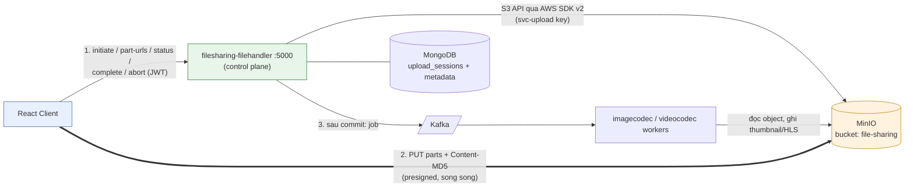
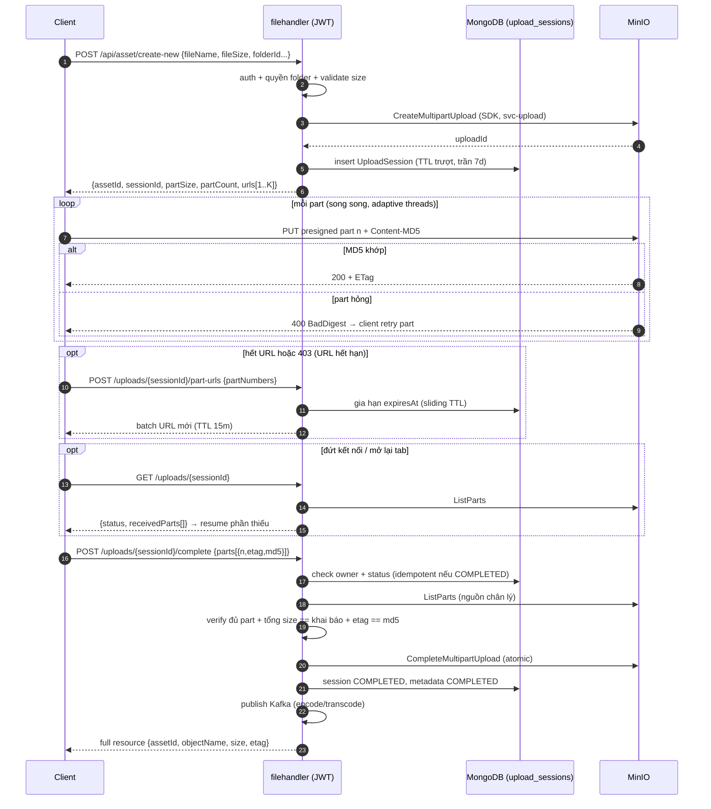
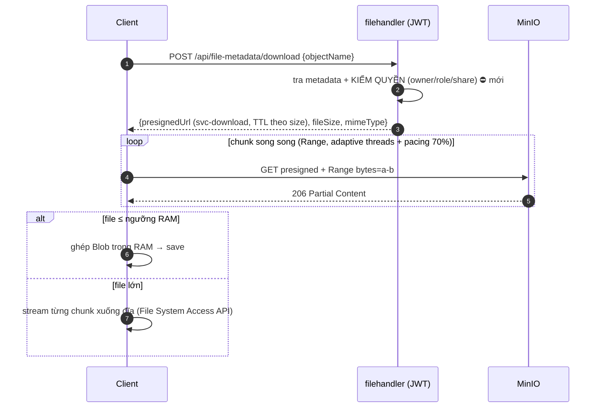
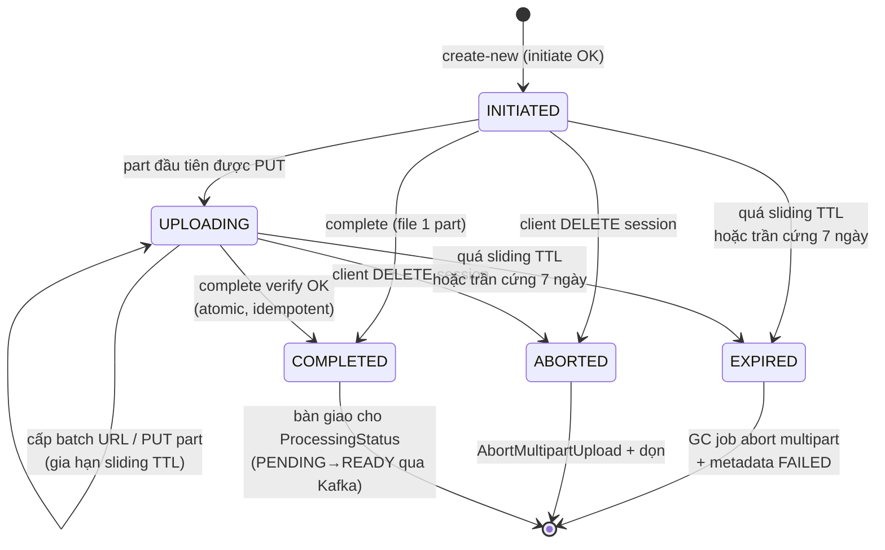

# System / Technical Design — Upload/Download Pipeline v2 (Presigned Direct, Hardened)

> **Tài liệu này trả lời:** phase nâng cấp này làm gì, pipeline mới hình dạng ra sao, công nghệ mới nào được đưa vào, và luồng hoạt động upload/download mới (sơ đồ mermaid). Chi tiết từng thay đổi xem `03_detailed_design.md`; hiện trạng và yêu cầu xem `01_user_requirement.md`.

---

## 1. Phase này làm gì (một đoạn)

Giữ nguyên đường byte **client ↔ MinIO qua presigned URL**, nhưng tổ chức lại thành pipeline 3 pha chuẩn (**initiate → transfer → commit**) với một thực thể mới làm xương sống: **UploadSession** (MongoDB, TTL trượt + trần cứng 7 ngày). Server trở thành nguồn chân lý duy nhất về `objectName`/`uploadId`/tiến độ; client chỉ cầm `sessionId` và các part URL ngắn hạn cấp theo batch. Commit được verify (quyền → đủ part → đúng size → đúng checksum) trước khi `CompleteMultipartUpload`. Presigned ký bằng service account scope hẹp thay cho root key. Download thêm kiểm quyền + TTL chuẩn hoá. Rác multipart được dọn tự động bằng lifecycle rule + GC job.

**Không đổi:** MinIO là data plane duy nhất; filehandler là control plane duy nhất; pipeline xử lý sau upload (Kafka → imagecodec/videocodec) giữ nguyên hợp đồng.

## 2. Công nghệ mới được áp dụng

| Công nghệ | Thay cho | Vai trò |
|---|---|---|
| **AWS SDK for Java v2** (`S3Client` + `S3Presigner`) | OkHttp + tự build XML + regex parse | Initiate/Complete/Abort/ListParts/Stat multipart là API public, có retry + typed error; presign part URL |
| **MinIO service accounts + IAM policy** | Root key ký mọi URL | `svc-upload` (chỉ multipart-write bucket `files`), `svc-download` (chỉ read) — thu hẹp blast radius khi URL rò rỉ |
| **MinIO ILM lifecycle rule** | (không có) | `AbortIncompleteMultipartUpload` sau 7 ngày — GC tầng storage |
| **MongoDB TTL index** trên `upload_sessions` | (không có session store) | Session tự hết hạn; TTL trượt bằng cách update `expiresAt` mỗi lần cấp batch URL |
| **Content-MD5 per part** (SparkMD5 có sẵn ở client) | So ETag rồi chỉ `console.warn` | MinIO tự verify từng part lúc ghi, part hỏng bị từ chối ngay (`BadDigest`) |
| **Spring `@Scheduled` GC + reconcile job** | (không có) | Quét session hết hạn → abort; đối soát Mongo ↔ MinIO định kỳ |

## 3. Pipeline mới

### 3.1 Upload — 3 pha

```
PHA 1  INITIATE   (control plane, JWT)
  client → POST /api/asset/create-new
  server: auth + quyền folder + validate size (long, ≤ MAX_FILE_SIZE)
          → sinh assetId, objectName, chọn partSize theo công thức
            clamp(max(8MiB, size/10000), 8MiB, 64MiB)
          → S3Client.createMultipartUpload → uploadId (KHÔNG trả về client)
          → tạo UploadSession {sessionId, owner, objectName, uploadId,
             declaredSize, partSize, partCount, expiresAt, hardExpiresAt}
          → cấp batch part-URL đầu tiên (TTL 15 phút)
  ← {assetId, sessionId, partSize, partCount, urls[1..K], expiresAt}

PHA 2  TRANSFER   (data plane, client ↔ MinIO trực tiếp)
  client cắt file theo partSize CỐ ĐỊNH, upload song song (adaptive threads),
  mỗi part kèm Content-MD5. Hết URL / URL hết hạn (403)
  → POST /api/uploads/{sessionId}/part-urls {partNumbers}  (server gia hạn session TTL)
  Mất trạng thái → GET /api/uploads/{sessionId} → parts đã nhận (ListParts) → resume

PHA 3  COMMIT     (control plane, JWT)
  client → POST /api/uploads/{sessionId}/complete {parts:[{n, etag, md5}]}
  server: check owner (từ session, TRƯỚC mọi thao tác storage)
          → ListParts từ MinIO = nguồn chân lý
          → verify: đủ part, Σsize == declaredSize, etag khớp md5 client
          → S3Client.completeMultipartUpload (atomic)
          → Mongo: status COMPLETED + ProcessingStatus + bắn Kafka
  ← full resource {assetId, objectName, size, etag, status}
  (gọi lại lần 2 → idempotent, trả kết quả cũ)
```

Pseudo code phần commit (điểm mấu chốt của toàn phase):

```
complete(sessionId, clientParts, user):
    s = sessions.find(sessionId)                 # 404 nếu không có / EXPIRED
    if s.owner != user: throw PERMISSION         # trước khi chạm storage
    if s.status == COMPLETED: return s.result    # idempotent
    real = s3.listParts(s.objectName, s.uploadId)     # không tin clientParts
    assert count(real) == s.partCount
    assert sum(real.size) == s.declaredSize           # chặn khai gian size
    for p in real: assert p.etag == clientParts[p.n].md5   # integrity precondition
    etag = s3.completeMultipartUpload(real)           # atomic, invisible trước đó
    mongo.tx: metadata.status = COMPLETED; session.status = COMPLETED
    kafka.publish(processing job)
    return resource
```

### 3.2 Download

```
client → POST /api/file-metadata/download {objectName | assetId}
server: tra metadata → KIỂM QUYỀN (owner / project role / share token)
        → presign GET bằng svc-download, TTL = clamp(size/minBandwidth, 15m..4h)
        → không log URL
client: giữ nguyên parallel Range download; file > ngưỡng RAM → stream xuống đĩa
```

## 4. Sơ đồ luồng hoạt động (mermaid)

### 4.1 Kiến trúc & đường đi dữ liệu



Đường nét đậm (2) là **data plane** — byte không bao giờ đi qua filehandler (trừ file ≤ ngưỡng nhỏ đi đường direct-upload cũ).

### 4.2 Sequence — Upload pipeline mới



### 4.3 Sequence — Download pipeline mới



### 4.4 Biểu đồ hoạt động — vòng đời UploadSession



## 5. Quyết định thiết kế đáng chú ý (và lý do)

1. **Part size cố định per-upload, server công bố** — bỏ adaptive chunk size ở client (giữ adaptive concurrency). Lý do: (a) part size biến thiên khiến offset không suy được từ partNumber → resume bất khả (đúng lỗi hiện tại R1); (b) số part xác định từ đầu → cấp URL theo batch chính xác; (c) theo research, server công bố granularity là mô hình của Google (`X-Goog-Upload-Chunk-Granularity`). Công thức chọn: `partSize = clamp(max(8MiB, ceil(size/10000)), 8MiB, 64MiB)` làm tròn lên nấc {8,16,32,64}MiB — mặc định 8MiB (trùng AWS CLI/boto3 và khuyến nghị GCS), chỉ nở lên khi trần 10.000 part của S3 bắt buộc (>~78GiB).
2. **`sessionId` là khoá duy nhất client được cầm** — `objectName`/`uploadId` không nhận từ client ở bất kỳ endpoint nào nữa (vá S3, S4). `uploadId` vẫn xuất hiện bên trong presigned URL (bắt buộc theo S3 protocol) nhưng không còn là input của API.
3. **`ListParts` là nguồn chân lý lúc commit** — không tin danh sách part client gửi; client chỉ bổ sung `md5` để làm precondition integrity (bài học "checksum là precondition, không chỉ metadata" — GCS).
4. **TTL trượt + trần cứng + GC 3 tầng** — sliding khi còn hoạt động (học Microsoft), trần 7 ngày (hằng số hội tụ của cả Google lẫn Microsoft), lifecycle rule + scheduled job + TTL index (không tầng nào là single point).
5. **Complete idempotent, trả full resource** — client mất response gọi lại vẫn an toàn; response đủ dữ liệu cập nhật UI không cần gọi thêm.
6. **Adaptive concurrency = hill-climbing trên tổng throughput, trần 6 thread** — client probe tăng thread, đo tổng throughput, lùi khi chạm plateau (mô hình AzCopy auto-tuner `AZCOPY_CONCURRENCY_VALUE=AUTO`; cùng họ AIMD/BBR của TCP). `MAX_THREADS=6` mặc định gắn với giới hạn ~6 kết nối/host của trình duyệt trên HTTP/1.1 (MinIO chạy plain HTTP → browser luôn HTTP/1.1); nâng trần chỉ có ý nghĩa khi có reverse proxy TLS+HTTP/2, và phải đo lại vì HTTP/2 dồn stream vào một kết nối TCP.

## 6. Ma trận đáp ứng yêu cầu

| Yêu cầu (01_user_requirement) | Cơ chế trong thiết kế |
|---|---|
| SEC-01 scope hẹp | svc-upload / svc-download service accounts |
| SEC-02 TTL nhiều tầng | URL 15m + session sliding/7d + ILM 7d |
| SEC-03 server giữ định danh | UploadSession + API theo sessionId |
| SEC-04 verify tại commit | pseudo code §3.1 |
| SEC-05 quyền download | bước kiểm quyền trong §3.2 |
| SEC-06 integrity | Content-MD5 per part + etag precondition |
| PERF-01/02 | batch URL + partSize server công bố (công thức §5.1) |
| PERF-06 | hill-climbing concurrency, trần 6 thread (§5.6) |
| REL-01/02 | GET session (ListParts) + complete idempotent |
| REL-03 GC | ILM + @Scheduled + TTL index |

Chi tiết endpoint spec, schema, thay đổi từng file/module: xem `03_detailed_design.md`.
