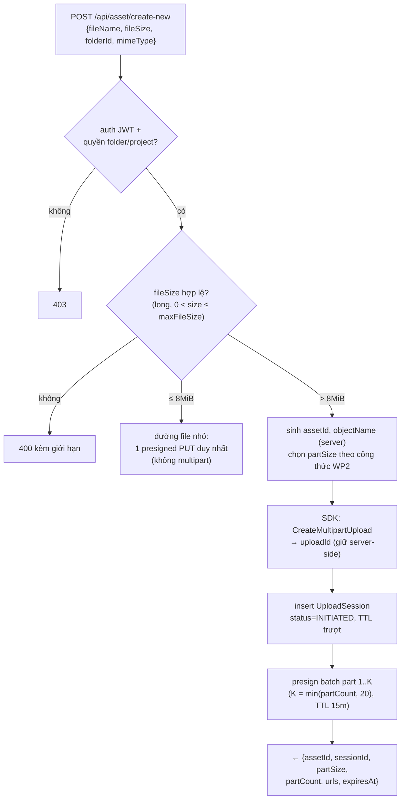
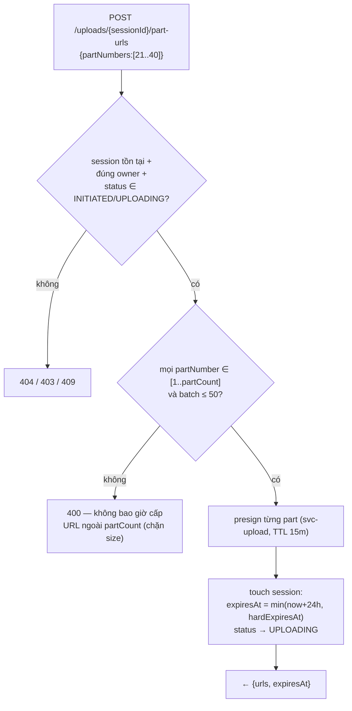
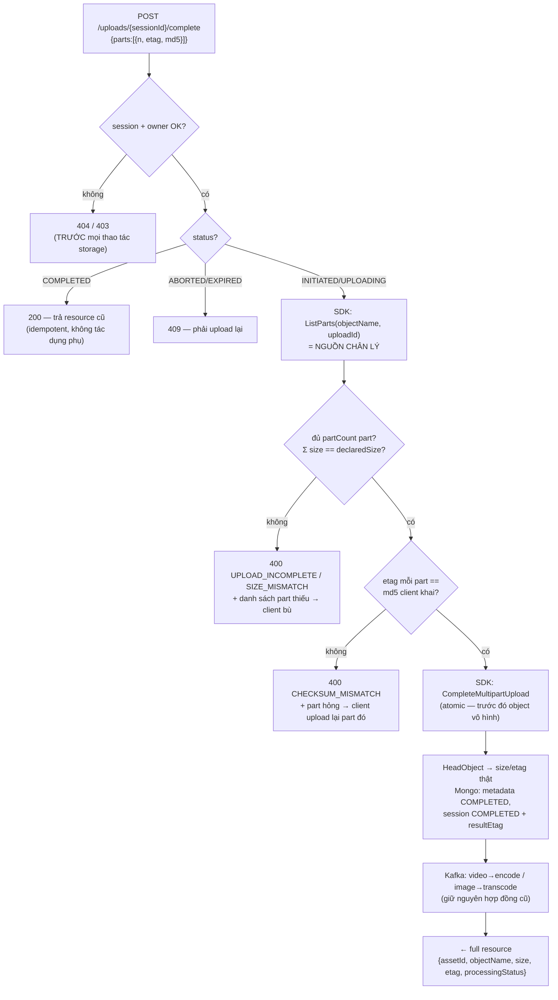
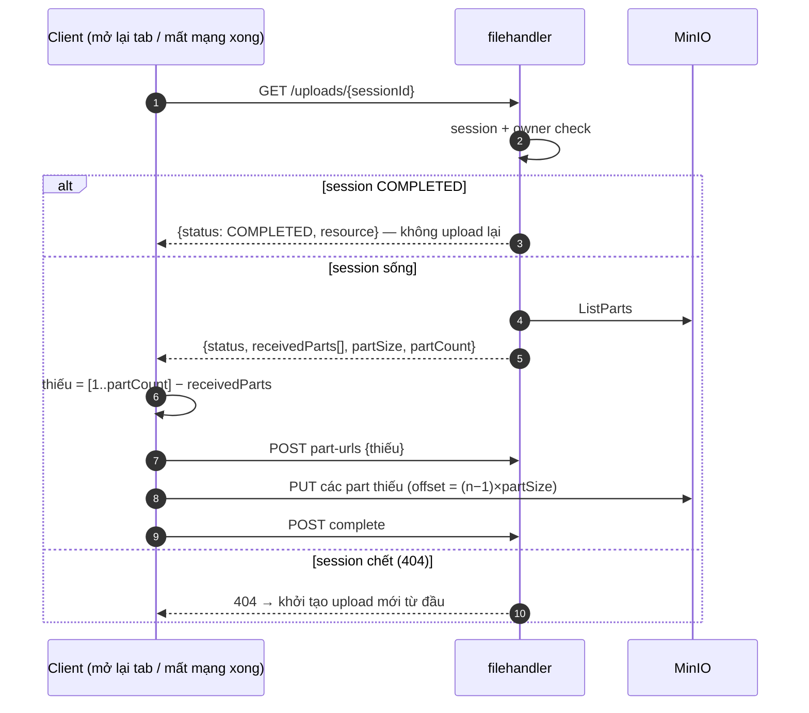
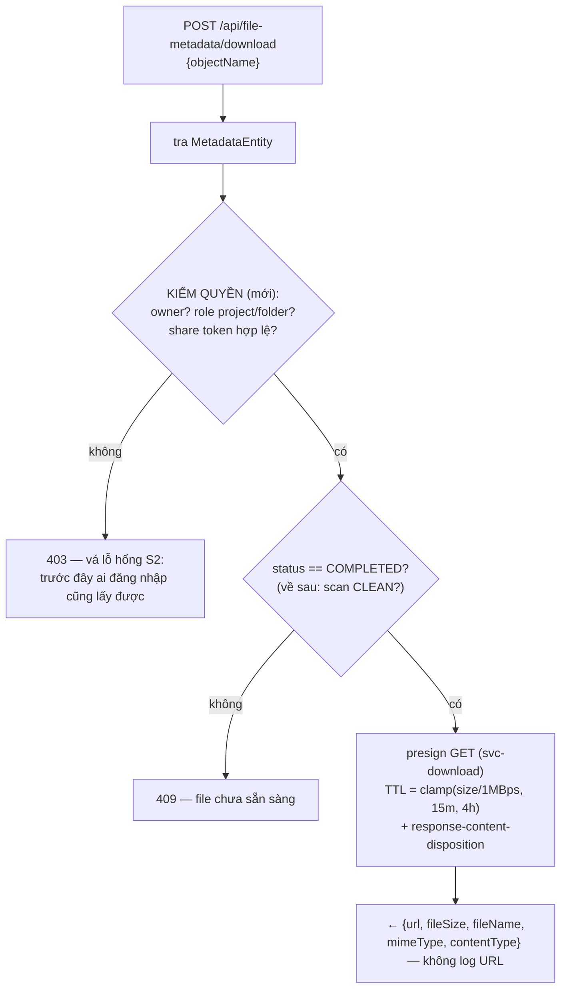
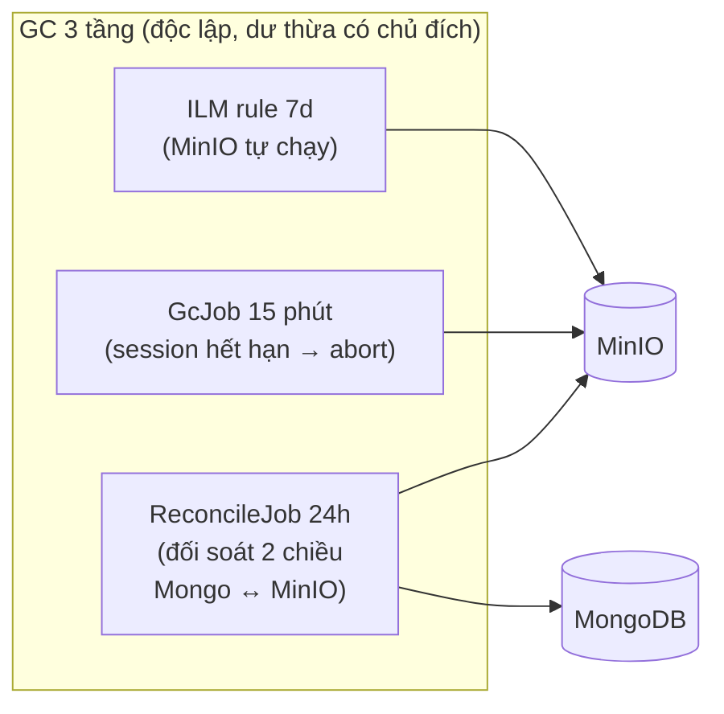

# Detailed Design — Upload/Download Pipeline v2

> **Tài liệu này trả lời:** phần nào của hệ thống cần nâng cấp, nâng cấp cụ thể những gì, và từng thay đổi ảnh hưởng trực tiếp đến kiến trúc ra sao. Mỗi luồng mới có sơ đồ riêng. Đọc kèm: `01_user_requirement.md` (hiện trạng + yêu cầu), `02_system_technical_design.md` (pipeline tổng thể).

Cấu trúc theo **Work Package (WP)** — thứ tự liệt kê cũng là thứ tự triển khai khuyến nghị (phụ thuộc: WP0 → WP1 → WP2 → WP3 → WP4 → WP5; WP6, WP7 song song từ sau WP2).

---

## WP0 — Gỡ bỏ `filesharing-uploadservice` (WebFlux stub)

### Hiện trạng
Module `server/filesharing-uploadservice/` (Spring WebFlux, :8080) là stub chưa bao giờ hoạt động: `UploadController.uploadChunks` throw `UnsupportedOperationException`, không có client nào gọi, không module nào phụ thuộc. Tham chiếu duy nhất từ bên ngoài: `server/pom.xml:37` (`<module>filesharing-uploadservice</module>`).

### Nâng cấp
1. Xoá dòng `<module>filesharing-uploadservice</module>` khỏi `server/pom.xml`.
2. Xoá toàn bộ thư mục `server/filesharing-uploadservice/`.
3. Xoá rule file mồ côi `.claude/rules/backend-uploadservice.md` (chỉ mô tả module vừa gỡ).
4. Build lại toàn repo (`mvn clean install` ở `server/`) xác nhận không còn tham chiếu.

### Ảnh hưởng kiến trúc
Chốt lại tuyên bố của PA2 ở tầng mã nguồn: **không có data-plane service nào giữa client và MinIO** — filehandler là control plane duy nhất, MinIO là data plane duy nhất. Loại bỏ một cửa mở kiến trúc dễ gây hiểu nhầm cho người mới (tưởng luồng chunk đi qua :8080) và một deploy unit chết khỏi CI.

---

## WP1 — Hạ tầng MinIO: credential scope hẹp + lifecycle

### Hiện trạng
Mọi `MinioClient` (filehandler, imagecodec, videocodec) dùng chung một **service account KHÔNG giới hạn policy** sinh từ root user (`init-bucket.sh:61` — `mc admin user svcacct add` trên `MINIO_ROOT_USER`, key nằm trong `application.yml`) — hệ quả bảo mật tương đương root key. Không có lifecycle rule; multipart dở tồn tại vô hạn. Bucket thumbnail truy cập public. Tên bucket thật: **`file-sharing`** (khoá config là `minio.buckets.files`), alias mc trong scripts là **`myminio`**.

### Nâng cấp
1. Tạo 2 service account bằng `mc admin user svcacct add` (hoặc script trong `server/dockers/scripts/`):
   - **`svc-upload`** — multipart-write trên bucket `file-sharing`, cộng 2 quyền phục vụ chính pipeline (HeadObject ở E4 cần `s3:GetObject`; reconcile WP6 cần `s3:ListBucketMultipartUploads` trên ARN bucket):
     ```json
     {
       "Version": "2012-10-17",
       "Statement": [
         {
           "Effect": "Allow",
           "Action": ["s3:PutObject", "s3:AbortMultipartUpload", "s3:ListMultipartUploadParts", "s3:GetObject"],
           "Resource": ["arn:aws:s3:::file-sharing/*"]
         },
         {
           "Effect": "Allow",
           "Action": ["s3:ListBucketMultipartUploads"],
           "Resource": ["arn:aws:s3:::file-sharing"]
         }
       ]
     }
     ```
   - **`svc-download`** — chỉ `s3:GetObject` trên `file-sharing/*` (mở rộng sang các bucket thumbnail/preview/hls khi triển khai SEC-10).
2. Filehandler cấu hình 2 bộ key này trong `application.yml` (`minio.svc-upload.*`, `minio.svc-download.*`); bean `MinioClient` cũ và workers **giữ key hiện có** phục vụ luồng legacy E7 — S1 chỉ khép hoàn toàn ở phase gỡ E7 (rủi ro ghi nhận có chủ đích).
3. Lifecycle rule trên bucket `file-sharing` — đường chính dùng `mc ilm import` với JSON chuẩn S3 (`AbortIncompleteMultipartUpload.DaysAfterInitiation = 7`); flag shorthand `--expire-abort-incomplete-multipart-upload 7d` phải verify bằng `mc ilm rule add --help` trước khi dùng (cú pháp khác nhau giữa các bản mc). Script nguyên văn: xem `agent/02_schema_config.md`.
4. (P2 — SEC-09) Bật audit log: `mc admin config set myminio audit_webhook endpoint=...`.

### Ảnh hưởng kiến trúc
- Xuất hiện **credential plane** tách bạch: control-plane call (initiate/complete/list/abort) và presign upload dùng `svc-upload`; presign download dùng `svc-download`. Root key rút về chỉ dùng cho admin/provisioning.
- Presigned URL rò rỉ giờ chỉ mang được quyền đúng bằng policy của service account — không đọc, không xoá, không list bucket.
- Lifecycle rule là lưới an toàn **độc lập với code**: kể cả khi GC job (WP6) chết, rác vẫn được dọn sau 7 ngày.

---

## WP2 — UploadSession: thực thể mới làm xương sống

### Hiện trạng
Không có khái niệm session. Trạng thái upload rải trên `MetadataEntity` (`uploadId`, `status`) và client tự giữ (`uploadId`, `objectName`, toàn bộ part URL). Client là người cầm và truyền lại `objectName`/`uploadId` cho complete/abort → server không có nguồn chân lý.

### Nâng cấp
Collection mới `upload_sessions` (MongoDB):

```
UploadSessionEntity {
  sessionId:      String   (UUID, _id)
  ownerId:        String   (indexed)
  assetId:        String
  metadataId:     String   (fileId của MetadataEntity version)
  objectName:     String   (server sinh — client không bao giờ gửi lên)
  uploadId:       String   (S3 multipart uploadId — không trả về client)
  declaredSize:   long     (bắt buộc > 0, ≤ maxFileSize)
  partSize:       long     (server chọn, cố định cho cả session)
  partCount:      int      (= ceil(declaredSize / partSize))
  partMd5:        Map<int, String>  (md5 client khai khi complete — lưu để đối soát)
  status:         INITIATED | UPLOADING | COMPLETED | ABORTED | EXPIRED
  createdAt:      Instant
  expiresAt:      Instant  (hết hạn logic, sliding — TTL index expireAfterSeconds = 172800, ADR agent/02 §1.5)
  hardExpiresAt:  Instant  (= createdAt + 7d; sliding không bao giờ vượt trần này)
  completedAt:    Instant?
  resultEtag:     String?  (etag object sau complete — phục vụ idempotent response)
}
```

- **TTL index** trên `expiresAt` với `expireAfterSeconds = 172800` (48h grace — ADR tại `agent/02_schema_config.md` §1.5): `expiresAt` là mốc **hết hạn logic** (GC job WP6 so sánh trực tiếp để abort multipart); Mongo chỉ xoá vật lý document sau đó 48h. Không thêm field hết hạn thứ hai.
- Sliding: mỗi lần cấp batch URL hoặc GET status → `expiresAt = min(now + idleTtl, hardExpiresAt)` với `idleTtl` mặc định 24h.
- Service mới `UploadSessionService` (filehandler, `services/`): create / get(+ownership check) / touch / markCompleted / markAborted; mọi controller đi qua đây, không đụng repo trực tiếp.

### Công thức chọn partSize (server công bố — PERF-02)

```
partSize = clamp( max(8MiB, ceil(declaredSize / 10000)), 8MiB, 64MiB )
           làm tròn LÊN nấc {8, 16, 32, 64} MiB
```

- **Mặc định 8MiB cho hầu hết mọi file** — trùng mặc định AWS CLI/boto3 (8MB), khuyến nghị tối thiểu của GCS (8MiB), vùng 5–10MiB của Microsoft Graph. Một part chạy ~3–13s trên mạng phổ thông (4G ~20Mbps) → chi phí retry nhỏ, resume mịn, RAM đang bay thấp (6 thread × 8MiB = 48MiB).
- Chỉ nở lên khi **trần 10.000 part của S3 bắt buộc**: >~78GiB → 16MiB, >~156GiB → 32MiB, >~312GiB → 64MiB (trần lý thuyết 640GiB). Với `maxFileSize` mặc định 50GiB, thực tế mọi file dùng 8MiB — công thức tồn tại để trần 10.000 part không bao giờ bị vi phạm khi nâng `maxFileSize` sau này.
- Tuỳ chọn (không bắt buộc phase này): client đo băng thông tại initiate và xin partSize lớn hơn theo `băng_thông × 15s`, server chọn từ nấc {8,16,32,64} và **cố định trong suốt session** — phục vụ đường truyền rất nhanh (LAN/fiber) nơi part 8MiB làm overhead per-request đáng kể.
- `≤ 8MiB`: đường file nhỏ, 1 request duy nhất, không multipart.

`maxFileSize` cấu hình (`upload.max-file-size`, đề xuất mặc định 50 GiB).

### Ảnh hưởng kiến trúc
- Client từ chỗ cầm 3 định danh (`objectName`, `uploadId`, partUrls) xuống còn **1** (`sessionId`). Vá triệt để S3/S4 của hiện trạng.
- `MetadataEntity` bỏ vai trò "session ngầm": `uploadId` trên metadata giữ lại chỉ để tương thích dữ liệu cũ, luồng mới đọc từ session.
- Resume (REL-01) trở nên khả thi vì `partSize` cố định → offset part n = `(n-1) × partSize`.

---

## WP3 — Storage layer: thay hand-rolled S3 call bằng AWS SDK v2

### Hiện trạng
`MinIoServiceImpl` presign URL admin (POST `?uploads`, POST `?uploadId`, DELETE `?uploadId`) rồi tự gọi bằng OkHttp, parse XML bằng regex, build XML complete bằng StringBuilder — vì minio-java giấu API multipart cấp thấp. Không retry, không typed error, lỗi R2 (tràn `intValue()`).

### Nâng cấp
Class mới `S3StorageService` (filehandler, `services/impl/`, ẩn sau interface `StorageService`), dùng `software.amazon.awssdk:s3`:

| Thao tác | Hiện tại | Mới |
|---|---|---|
| Initiate | presign POST `?uploads` + OkHttp + regex | `s3.createMultipartUpload(...)` |
| Presign part | `minioClient.getPresignedObjectUrl(PUT, extraQueryParams)` | `S3Presigner.presignUploadPart(...)` — TTL 15 phút đồng nhất |
| List parts | (không có) | `s3.listParts(...)` — nguồn chân lý cho complete/resume |
| Complete | presign POST + XML StringBuilder | `s3.completeMultipartUpload(...)` |
| Abort | presign DELETE + OkHttp | `s3.abortMultipartUpload(...)` |
| Stat sau commit | (không có) | `s3.headObject(...)` — lấy size/etag thật ghi vào metadata |
| Presign download | `getPresignedObjectUrl(GET)` (minio-java) | `S3Presigner.presignGetObject(...)` bằng key `svc-download` |

- `S3Client` cấu hình `endpointOverride` = MinIO endpoint, `forcePathStyle(true)`, region cố định (`us-east-1`).
- Hai bean presigner: `uploadPresigner` (svc-upload key), `downloadPresigner` (svc-download key).
- **Quyết định (user chốt 2026-09-01): XOÁ helpers cũ ngay trong WP3.** `calculateExpireTime`, `extractUploadIdFromXml`, `buildCompleteMultipartUploadXml`, field `OkHttpClient` bị xoá; các method multipart của `MinIoServiceImpl` được **rewire thành adapter** gọi `StorageService`. 3 endpoint legacy E7 giữ nguyên **hợp đồng** (URL, request/response schema — vẫn trả `uploadId` + toàn bộ `partUrl`), nhưng hành vi nội bộ đổi và được chấp nhận: part URL sinh bằng SDK với **TTL đồng nhất** `clamp(partCount × 60s, 1h, 6h)` thay công thức theo partNumber (file lớn legacy không chết oan), complete/abort đi qua SDK. Client cũ không đọc TTL từ response nên hợp đồng không vỡ.
- `fileSize` đổi `Double` → `long` trên chuỗi gọi của API MỚI (REL-04); các call site còn lại xử lý ở WP7.

### Ảnh hưởng kiến trúc
- Lớp storage trở thành **S3-generic**: filehandler nói chuyện với MinIO thuần bằng giao thức S3 chuẩn qua SDK có retry/backoff — đổi backend S3-compatible sau này không đụng business logic.
- Các bug lớp thấp (R2 tràn số, regex XML, thiếu retry) biến mất cùng code bị xoá.

---

## WP4 — API control plane mới (filehandler)

### Hiện trạng
4 endpoint: `upload-metadata` (legacy), `asset/create-new`, `upload/complete`, `upload/stop-upload` — tất cả nhận `objectName`/`uploadId` từ client, không verify, không resume, không idempotent.

### Điều kiện tiên quyết (phát hiện khi rà code — chặn toàn bộ WP4)

`GlobalExceptionHandler` ở **filesharing-core** (`exceptions/GlobalExceptionHandler.java:42-44`) hiện trả HTTP **500 cho mọi** `FileBusinessException`/`UserBusinessException`, bỏ qua `errorCode.getHttpStatus()`. Toàn bộ hợp đồng 403/404/409/429 của E1–E6 không thể xảy ra nếu không sửa. **Việc sửa nằm trong phạm vi WP4**, nhưng cần ý thức blast radius: core là thư viện dùng chung — sau sửa, MỌI module trả đúng mã lỗi thật thay vì 500 (hành vi lỗi đổi trên toàn hệ thống; client nào đang bắt cứng 500 sẽ thấy khác). Kèm theo: enum `ErrorCode` thêm **7 mã mới** (4 mã đã chốt + `SESSION_INVALID_STATE` 409, `SESSION_LIMIT_EXCEEDED` 429, `FILE_NOT_READY` 409 — chi tiết tại `agent/01_api_contract.md` §9).

### Nâng cấp — bảng endpoint

| # | Endpoint | Thay đổi | Vá yêu cầu |
|---|---|---|---|
| E1 | `POST /api/asset/create-new` | **Mở rộng response**: thêm `sessionId`, `partSize`, `partCount`, `urls` (batch đầu), `expiresAt`; bỏ trả `uploadId` + toàn bộ partUrl. Giữ shape entity-trong-DTO hiện tại — **nợ kỹ thuật đã duyệt** (không map sang DTO trong phase này, tránh phình phạm vi) | SEC-03, PERF-01/02 |
| E2 | `POST /api/uploads/{sessionId}/part-urls` | **Mới** — body `{partNumbers:[...]}` (≤ 50/lần, chỉ trong `1..partCount`); trả `{urls:{n:url}, expiresAt}`; touch sliding TTL | PERF-01, SEC-02 |
| E3 | `GET /api/uploads/{sessionId}` | **Mới** — trả `{status, receivedParts:[{partNumber,size,etag}], partSize, partCount, expiresAt}`; nếu `COMPLETED` trả luôn resource (chống double-commit) | REL-01 |
| E4 | `POST /api/uploads/{sessionId}/complete` | **Mới** (thay `upload/complete`) — body `{parts:[{partNumber, etag, md5}]}`; verify rồi commit; idempotent | SEC-04, REL-02 |
| E5 | `DELETE /api/uploads/{sessionId}` | **Mới** (thay `upload/stop-upload`) — abort multipart + session ABORTED + metadata FAILED | REL-05 |
| E6 | `POST /api/file-metadata/download` | **Giữ URL, thêm kiểm quyền** + TTL chuẩn + fix field `mimeType`→ trả cả `contentType` | SEC-05, R4 |
| E7 | `POST /api/file-metadata/upload-metadata`, `upload/complete`, `upload/stop-upload` | **Deprecated** — giữ hoạt động 1 phase, log warning, xoá ở phase sau | B.4 |

Mọi endpoint E2–E5: bước đầu tiên là `UploadSessionService.get(sessionId, currentUserId)` — session không tồn tại/hết hạn → 404 `SESSION_NOT_FOUND`; sai owner → 403 `FILE_PERMISSION_ERROR` (dùng `FileBusinessException` + `ErrorCode` theo convention backend, không `RuntimeException`).

### Luồng E1 — Initiate (sơ đồ)



### Luồng E2 — Cấp part-URL theo batch (sơ đồ)



### Luồng E4 — Complete có verify (sơ đồ — trái tim của phase)



### Luồng E3 — Resume (sơ đồ)



### Luồng E6 — Download (sơ đồ)



### Ảnh hưởng kiến trúc
- Bộ API upload chuyển từ "RPC rời rạc quanh MinIO" thành **resource-oriented session API** (`/api/uploads/{sessionId}/*`) — đúng mô hình 3 pha của research; các endpoint legacy (E7) chỉ còn là adapter chờ gỡ.
- Kiểm quyền dồn về 2 chốt: initiate và complete/download — quyền được "chốt tại initiate, re-check tại commit/download" (bài học GCS).

---

## WP5 — Client: uploadService/downloadService v2

### Hiện trạng
Client tự sinh `objectName` (legacy), giữ toàn bộ part URL từ đầu, adaptive chunk size 5–50MiB, MD5 chỉ để warn, không resume, download ghép RAM.

### Nâng cấp (`client/src/service/`)

1. **`uploadService`**:
   - Chunk size = `partSize` server trả (cố định) — **xoá adaptive chunk size**; adaptive chỉ còn ở concurrency, nâng cấp thành hill-climbing (mục kế tiếp).
   - **Adaptive concurrency v2 — hill-climbing trên TỔNG throughput.** Cửa sổ mục tiêu 1–5s/chunk cũ được hiệu chỉnh cho chunk co giãn 5–50MiB; khi part cố định, trên mạng chậm mọi part đều vượt 5s và thuật toán cũ sẽ đòi "giảm công suất" sai. Tín hiệu điều khiển đổi thành tổng throughput đo được:

     ```
     mỗi khi một part hoàn thành:
         aggregate = EWMA(tổng bytes hoàn thành / giây, cửa sổ trượt)
         if lỗi liên tiếp (panic):              threads-- (floor 1)
         elif threads < MAX_THREADS:
             threads++ (probe)
             sau K part kế tiếp: nếu aggregate tăng < 10%   # plateau — pipe đã đầy
                 → lùi về threads−1 và giữ ổn định (không probe lại ngay)
             ngược lại → giữ mức mới, tiếp tục leo
     ```

     - **`MAX_THREADS = 6`** (config `upload.max-threads`): gắn trực tiếp với giới hạn **~6 kết nối đồng thời/host của trình duyệt trên HTTP/1.1** — MinIO đang chạy plain HTTP (không TLS) nên trình duyệt luôn ở HTTP/1.1; thread thứ 7 trở đi chỉ xếp hàng trong browser, không song song thật. Chỉ nâng trần khi đặt MinIO sau reverse proxy TLS + HTTP/2 (và phải đo lại — HTTP/2 dồn mọi stream vào một kết nối TCP, chưa chắc lợi cho bulk upload).
     - Mô hình probe → stable zone → back-off này là cách **AzCopy auto-tuner** (`AZCOPY_CONCURRENCY_VALUE=AUTO`) dò số kết nối song song tối ưu cho cùng bài toán upload object storage; cùng họ với AIMD/BBR của TCP congestion control.
     - Giữ nguyên từ thuật toán cũ: EWMA (alpha 0.3), `Semaphore.updateMaxPermits`, retry 3 lần + backoff + jitter, panic mode (chỉ còn vế giảm thread), network stability theo CV.
   - **PartUrlManager** mới: giữ pool URL; prefetch batch kế tiếp khi pool còn < ngưỡng (ví dụ còn 5 URL); khi PUT trả 403 (URL hết hạn) → xin lại URL cho đúng part đó rồi retry (không tính vào 3 lần retry lỗi mạng).
   - Mỗi part gửi header **`Content-MD5`** (base64 của MD5 — SparkMD5 đã tính sẵn); nhận `BadDigest` → retry part. So ETag sau upload: từ `warn` → **fail part + retry**.
   - Complete gửi `{partNumber, etag, md5}` cho E4; nhận `UPLOAD_INCOMPLETE`/`CHECKSUM_MISMATCH` → tự bù part rồi complete lại.
   - Resume: trước khi bắt đầu, nếu có `sessionId` lưu trong `localStorage` (persist theo bài học "client PHẢI persist session") → gọi E3, upload phần thiếu.
   - Abort → `DELETE /uploads/{sessionId}`.
2. **`downloadService`**:
   - Đọc `contentType` từ field mới (fix R4).
   - File > ngưỡng (cấu hình, đề xuất 1 GiB): dùng File System Access API (`showSaveFilePicker` + ghi từng chunk theo thứ tự) thay vì ghép Blob RAM; giữ nguyên parallel Range + pacing.
3. Chạy `npm run gen-api` sau khi server đổi DTO (convention của repo — không hand-edit `src/api/api/`).

### Ảnh hưởng kiến trúc
- Client không còn giữ bí mật dài hạn nào: URL sống 15 phút, sessionId vô dụng với người không có JWT của owner.
- Thuật toán client đơn giản đi đáng kể (một biến số ít hơn: chunk size), đổi lại có resume thật — đây là trade-off có chủ đích: adaptive size chỉ có ích trên mạng biến thiên mạnh, còn adaptive concurrency giữ được ~phần lớn lợi ích throughput.

---

## WP6 — GC & đối soát

### Hiện trạng
Không có gì: multipart dở tồn tại vô hạn (R3), `timeToLive` là field chết (S7).

### Nâng cấp — 3 tầng độc lập

| Tầng | Cơ chế | Chu kỳ | Việc làm |
|---|---|---|---|
| 1 | MinIO ILM (WP1) | MinIO tự chạy | Abort multipart dở > 7 ngày — lưới an toàn cuối |
| 2 | `UploadSessionGcJob` (`@Scheduled`, filehandler) | 15 phút | Quét session `expiresAt < now` hoặc `hardExpiresAt < now` mà status còn sống → `abortMultipartUpload` + session EXPIRED + metadata FAILED |
| 3 | `UploadReconcileJob` | 24h | `ListMultipartUploads` trên bucket `files` đối chiếu `upload_sessions`: multipart không có session (mồ côi) → abort; session COMPLETED mà object không tồn tại (HeadObject 404) → alert + metadata FAILED |



### Ảnh hưởng kiến trúc
Vòng đời dữ liệu staging lần đầu tiên **khép kín**: mọi byte đi vào MinIO đều có đúng một trong ba kết cục — committed (complete), aborted (client/GC), hoặc expired (ILM). Không còn trạng thái "tồn tại vô hình vô hạn".

---

## WP7 — Vệ sinh nền & deprecation

| Việc | Chi tiết | Vá |
|---|---|---|
| Bật scheduling cho filehandler | Thêm `@EnableScheduling` vào `FileSharingApplication` — hiện chỉ imagecodec/videocodec bật; thiếu nó WP6 không chạy | (WP6) |
| `fileSize` `Double` → `long` | Đủ 6 file có call site: `MetadataServiceImpl`, `AssetServiceImpl`, `DashboardServiceImpl`, `ProcessingServiceImpl`, `ImageDataController`, `FileMetadataController` (dòng 108 còn ép `(double) file.getSize()`) + `MetadataDTO`, `MetadataEntity`, `AssetCreateRequestDto`. Chiến lược dữ liệu cũ (Mongo đang lưu BSON double): `@Field(targetType = FieldType.INT64)` cho ghi mới + đọc tương thích, KHÔNG migration | R5, R2 |
| Log hygiene | Xoá mọi `log.info`/`console.log` in presigned URL (`MinIoServiceImpl:192,249-250`, `fileApiResource.ts:83`); log chỉ `sessionId` + `partNumber` | SEC-07 |
| Giới hạn session | Tối đa N session mở đồng thời / user (đếm trong `upload_sessions`, mặc định 20) → 429 | SEC-08 |
| Deprecate legacy | E7: `upload-metadata`, `upload/complete`, `upload/stop-upload` gắn `@Deprecated` + warning log; client `uploadService.uploadFile()` (đường legacy tự sinh objectName) chuyển sang gọi luồng asset | S3 |
| `contentType` fix | `DownloadFileResponseDto` server trả thêm field `contentType` (giữ `mimeType` để tương thích) | R4 |

---

## Rollout & tương thích ngược

```
Bước 0  WP0 (gỡ filesharing-uploadservice — dọn phạm vi trước khi xây, độc lập mọi bước sau)
Bước 1  WP1 (hạ tầng — thuần cấu hình, deploy độc lập, có thể làm ngay)
Bước 2  WP2 + WP3 (session + SDK — chưa đổi API công khai, legacy vẫn chạy)
Bước 3  WP4 (API mới song song API cũ; API cũ deprecated nhưng sống)
Bước 4  WP5 (client chuyển sang API mới; gen-api lại)
Bước 5  WP6 + WP7 (GC, vệ sinh, siết legacy)
Phase sau: xoá E7, SEC-09 audit log, SEC-10 thumbnail presigned, malware scan hook
```

- Trong bước 3–4, hai thế hệ client chạy song song được với E2–E5 (namespace mới `/api/uploads/*`) — **NHƯNG E1 thì không**: response `create-new` mới bỏ `upload.uploadId`/`upload.partUrl` mà client hiện tại bắt buộc phải có (`folderUploadService.ts:160-167` throw nếu thiếu). **WP4-E1 và WP5 phải ra cùng một release.** Các endpoint E2–E5 deploy trước được.
- Đường file nhỏ: nhánh SINGLE mới (≤ 8MiB, 1 presigned PUT) là đường chính của luồng asset; endpoint legacy `/direct-upload` (proxy, trần 5MiB) giữ nguyên không đổi và gỡ cùng E7.
- Dữ liệu cũ: `MetadataEntity` có `uploadId` nhưng không có session → GC job **bỏ qua** metadata không có session tương ứng (chỉ ILM dọn phần MinIO của chúng).

## Rủi ro & biện pháp

| Rủi ro | Mức | Biện pháp |
|---|---|---|
| ETag ≠ MD5 khi MinIO bật SSE-KMS/encryption sau này → check `etag == md5` ở E4 gãy | Trung bình | Verify này đặt sau flag cấu hình `upload.verify-etag-md5` (mặc định on với MinIO không SSE); tổng-size check không phụ thuộc điều này |
| Client cũ (chưa update) gọi API cũ sau khi siết | Thấp | Giữ E7 nguyên **hợp đồng** tới khi client release xong (hành vi TTL nội bộ đổi — đã duyệt 2026-09-01); theo dõi warning log để biết còn traffic không |
| TTL index Mongo xoá session trước khi GC job kịp abort MinIO | Thấp | Đã chốt (ADR `agent/02_schema_config.md` §1.5): TTL index trên `expiresAt` với `expireAfterSeconds = 172800` — session chết logic tại `expiresAt`, document xoá vật lý sau 48h |
| `Content-MD5` trên presigned PUT nằm ngoài SignedHeaders — MinIO có thực sự validate và trả `BadDigest`? | Trung bình | **Smoke test bắt buộc ở WP3** trước khi WP5 phụ thuộc; nếu không validate → SEC-06 chuyển sang ký kèm MD5 lúc presign (đổi hợp đồng E2: client khai md5 trước khi xin URL) |
| Sửa `GlobalExceptionHandler` (core) đổi hành vi lỗi TOÀN hệ thống (500 → mã thật) | Trung bình | Nằm trong WP4 có chủ đích; kiểm tra client hiện tại không bắt cứng 500; smoke test các flow lỗi chính của module khác sau khi sửa |
| Cú pháp `mc ilm` khác nhau giữa các bản mc | Thấp | Đường chính dùng `mc ilm import` JSON chuẩn S3; verify flag shorthand bằng `--help` trước khi dùng |
| Batch URL 15 phút quá ngắn cho mạng rất chậm (part 64MiB @ <1Mbps) | Thấp | Client xin lại URL cho part chưa upload là hành vi chuẩn (không phải lỗi); TTL nâng qua config `upload.part-url-ttl` |
| `forcePathStyle` / chữ ký SDK v2 lệch với MinIO phiên bản cũ | Thấp | MinIO RELEASE.2025-06 tương thích SigV4 path-style đầy đủ; smoke test ở bước 2 |
